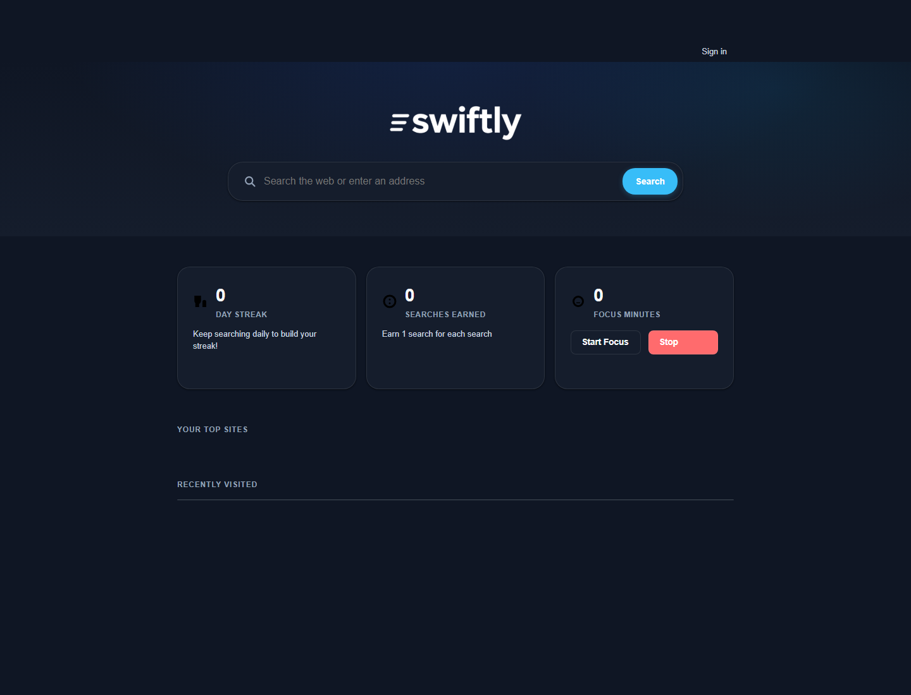
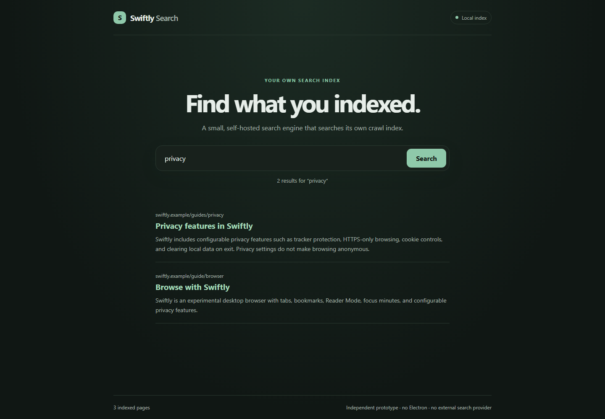

# Swiftly

Swiftly is an experimental desktop browser built with Electron. It combines a
tabbed browser with a built-in, multi-provider search engine and local browsing
tools, with an emphasis on a clean interface and configurable privacy features.

Swiftly is under active development; features and behavior may change.

## Features

- Search from the start page or address bar, with provider selection, region,
  Safe Search, suggestions, and configurable result counts.
- Try a separate, experimental local search engine that builds and searches its
  own crawl index without Electron or third-party search providers.
- Browse with tabs, bookmarks, browsing history, downloads, session restore,
  and optional background-tab hibernation.
- Use Reader Mode to simplify articles, or Speed Reader for adjustable text
  size and a distraction-free reading view.
- Choose a light, dark, or system theme; manage zoom, spelling, and other
  browsing preferences in Settings.
- Configure the built-in Privacy Shield, Do Not Track, third-party cookie
  blocking, HTTPS-only mode, and clearing browsing data on exit.
- Open an incognito window with a separate in-memory browser session.
- Track focus minutes from the start page.

## Screenshots

The start page is rendered from the app's page source. Swiftly Search is shown
with an illustrative local demo index; those sample results are not shipped.





## Independent local search prototype

The browser's existing web search aggregates results from external providers.
The separate `search-engine/` prototype is a different, genuinely local
search path: it indexes pages you choose to crawl and ranks results from that
index. It does not call Bing, Brave, Startpage, DuckDuckGo, or Electron. The
service uses Node.js built-ins only; the Electron dependency remains for the
desktop browser elsewhere in this repository.

Start by crawling a site you are allowed to index, then launch the local web
interface:

```sh
node search-engine/crawl.js https://example.com --max-pages 25
node search-engine/server.js
```

Open <http://127.0.0.1:4177>. The crawler stays on the seed site's origin,
honors `robots.txt` and `noindex`/`nofollow`, waits at least one second between
requests to the same origin, and caps each crawl at 100 pages and each response
at 1 MiB. Query strings are stripped during URL normalization to avoid
parameter-based crawl traps, so query-dependent pages are not indexed. Search
data is stored locally in `~/.swiftly-search/index.json`
(override the directory with `SWIFTLY_SEARCH_DATA`). The server binds to
`127.0.0.1` and does not expose a remote crawl endpoint.

This is an early prototype, not a web-scale index: results are limited to
pages you have crawled.

## Run from source

### Requirements

- Node.js 18 or newer and npm
- A desktop environment supported by Electron

### Install and launch

```sh
git clone https://github.com/pendekarbau6-create/Swiftly-Public-Beta-.git
cd Swiftly-Public-Beta-
npm ci
npm start
```

For development, use `npm run dev`. To run the automated tests, use:

```sh
npm test
```

Equivalent convenience commands are `npm run search:web` and
`npm run search:crawl -- https://example.com --max-pages 25`.

## Privacy and data

Swiftly keeps profile information, preferences, bookmarks, downloads, and
browsing history on the local computer. Profiles do not currently sync between
devices. Incognito windows use a separate in-memory session and are excluded
from saved browsing history.

Privacy settings provide useful protections but do not make browsing anonymous
or guarantee that every ad or tracker is blocked. Do Not Track is a request to
websites, not an enforcement mechanism. Browser web searches and website visits
send network requests to the selected search providers and destination sites.
Queries to the independent local search service are searched against its local
index; its crawler makes requests to the seed sites you choose.

## Project layout

```text
src/
  main/       Electron main process, tabs, storage, and network controls
  pages/      Start page and internal browser pages
  preload/    Restricted APIs exposed to the UI
  renderer/   Browser chrome and tab interface
  search/     Search engine and provider integrations
search-engine/ Standalone local crawler, index, search API, and web UI
test/         Automated tests
```

## Development commands

| Command | Description |
| --- | --- |
| `npm start` | Launch Swiftly |
| `npm run dev` | Launch Swiftly in development mode |
| `npm test` | Run the automated test suite |

## Contributing and license

See [CONTRIBUTING.md](CONTRIBUTING.md) for setup and pull request guidance.
Contributions are covered by the [Code of Conduct](CODE_OF_CONDUCT.md). Swiftly
is available under the [MIT License](LICENSE); see [CHANGELOG.md](CHANGELOG.md)
for release history.
